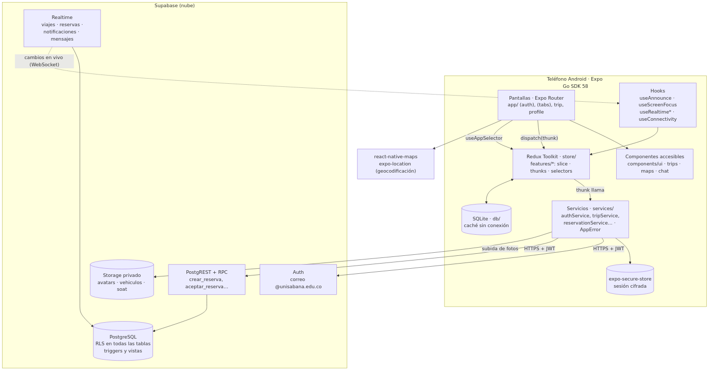

# CampusGo

**Conectando estudiantes, compartiendo trayectos.** By Sara y Samuel.

CampusGo es una app móvil de carpooling para la comunidad de la Universidad de La Sabana. Conecta conductores y pasajeros para compartir trayectos hacia y desde el campus en una **red cerrada** (solo correos `@unisabana.edu.co`) y **sin comisiones**: el valor por cupo es una referencia que fija el conductor y el pago ocurre fuera de la app.

Proyecto del curso Desarrollo de Aplicaciones Móviles (profesor Santiago Rivadereina), Universidad de La Sabana, por Sara Santacruz Corredor y Samuel Borda Munevar.

- Documento técnico final: [docs/DOCUMENTO_FINAL.md](docs/DOCUMENTO_FINAL.md) (y su PDF en `docs/`).
- Guion de la presentación: [docs/PRESENTACION.md](docs/PRESENTACION.md).

## Qué hace

| Modo pasajero | Modo conductor |
| --- | --- |
| Buscar viajes por sector y cupos, en una lista paginada | Registrar su carro (placa, cupos, fotos del carro y del SOAT) |
| Reservar eligiendo el punto de recogida en el mapa o escribiéndolo | Crear viajes con origen, destino, fecha, hora, cupos y valor |
| Ver sus reservas como pendientes, aceptadas o rechazadas, y cancelarlas | Aceptar o rechazar solicitudes; el viaje se cierra solo al llenarse |
| Chatear con el conductor y calificarlo al finalizar | Iniciar y finalizar el viaje, chatear y calificar a sus pasajeros |

Además: notificaciones en tiempo real, caché sin conexión, perfil editable y ajustes de accesibilidad (tema, tamaño de texto, reducir movimiento y vibración).

## Requisitos

- Node.js 22.13 o superior (en la línea 22) o 24.3 o superior.
- Expo Go para SDK 58 en un teléfono Android. Si Google Play ofrece una versión anterior, instálalo desde https://expo.dev/go, o deja que Expo CLI lo instale (tecla `a` con el teléfono conectado por USB o con un emulador).
- Una cuenta de Supabase (plan gratuito) con un proyecto creado.

## Variables de entorno

Se copian de `.env.example` a `.env`. El archivo `.env` está ignorado por Git y **nunca** se sube.

| Variable | Qué es | Dónde se obtiene |
| --- | --- | --- |
| `EXPO_PUBLIC_SUPABASE_URL` | URL del proyecto de Supabase | Supabase > Project Settings > API > Project URL |
| `EXPO_PUBLIC_SUPABASE_ANON_KEY` | Llave pública (anon o publishable). Es pública por diseño: lo que protege los datos es RLS | Supabase > Project Settings > API > anon public key |

La llave `service_role` **nunca** va en la app ni en el repositorio.

## Preparar Supabase (una sola vez por proyecto)

1. **Base de datos:** en el SQL Editor, ejecuta en orden los archivos de `supabase/migrations`, de `0001` a `0009`, uno por uno. Luego ejecuta `supabase/seed.sql`, que crea los sectores.
2. **Comprobar la seguridad:** pega `supabase/tests/rls.sql` completo en el SQL Editor y ejecútalo. Debe terminar con "RESULTADO RLS: 92 de 92 correctas". El script usa cuentas ficticias y al final deshace todo.
3. **Auth:** en Authentication > Sign In / Providers > Email, apaga **"Confirm email"**. La app solo acepta correos `@unisabana.edu.co`, en la app y en la base, y la cuenta queda activa al registrarse (decisión D-68). Para pedir el código de 6 dígitos hace falta un SMTP propio: con él, enciende "Confirm email" y pon `{{ .Token }}` en la plantilla "Confirm signup"; la app muestra sola la pantalla "Verifica tu correo".
4. **Storage:** la migración `0002` crea los buckets privados `avatars`, `vehiculos` y `soat` con sus políticas.
5. **Datos de prueba (opcional):** `supabase/dev_seed_viajes.sql` crea 10 viajes de prueba para una conductora; cambia el correo dentro del archivo antes de ejecutarlo. `supabase/dev_limpiar_viajes.sql` deja solo 10 viajes de prueba.

## Instalar y correr

```sh
git clone https://github.com/sarastacruz04/campusgo.git
cd campusgo
npm install
cp .env.example .env   # pega la URL y la anon key
npx expo start
```

Escanea el código QR con Expo Go. El teléfono y el computador deben estar en la misma red; si no, usa `npx expo start --tunnel`.

## Scripts

| Script | Qué hace |
| --- | --- |
| `npm start` | Inicia el servidor de desarrollo de Expo. |
| `npm run android` | Inicia y abre la app en un Android conectado o en el emulador. |
| `npm run typecheck` | Revisa los tipos con TypeScript estricto. |
| `npm run lint` | ESLint con reglas de Expo, Prettier y accesibilidad (`eslint-plugin-react-native-a11y`). |
| `npm run format` | Formatea el código con Prettier. |
| `npm test` | Pruebas con jest-expo y Testing Library (259 pruebas). |
| `npm run a11y:contrast` | Verifica que los 66 pares de color cumplan WCAG AA en los temas claro, oscuro y alto contraste. |

## Arquitectura



- **Pila:** Expo SDK 58 (React Native 0.88, React 19), TypeScript estricto, Expo Router, Redux Toolkit, Supabase (Auth, PostgreSQL con RLS, Realtime y Storage), `expo-secure-store`, `expo-sqlite`, `react-native-maps` y `expo-location`. Funciona en Expo Go, sin módulos nativos propios.
- **Flujo de datos:** pantalla → `dispatch(thunk)` → servicio → Supabase → reducer → selector → pantalla. Las pantallas no llaman a Supabase y los componentes de `components/ui` no conocen Redux.
- **Reglas de negocio en la base:** funciones RPC transaccionales (por ejemplo, `aceptar_reserva` cierra el viaje al llenarse), triggers y RLS en todas las tablas.

| Carpeta | Contenido |
| --- | --- |
| `app/` | Rutas de Expo Router: `(auth)`, `(tabs)`, `trip/`, `profile`, `notifications`, `requests`, `settings/accessibility` |
| `components/` | `ui/` (componentes accesibles base), `trips/`, `maps/`, `chat/`, `ratings/`, `notifications/` |
| `features/` | Un dominio por carpeta (auth, profile, vehicle, trips, reservations, notifications, chat, ratings, settings), con `slice`, `thunks` y `selectors` |
| `services/` | Un servicio por dominio, el cliente de Supabase con sesión cifrada y `AppError` con mensajes en español |
| `db/` | Caché SQLite para usar la app sin conexión |
| `hooks/`, `theme/`, `lib/` | Anuncios, foco, háptica y Realtime; tokens de color, tipografía y `TOUCH_MIN`; validadores y formato |
| `supabase/` | Migraciones, semilla, datos de prueba y pruebas SQL de RLS |
| `docs/` | Documento final, especificación, decisiones, contratos, pruebas, auditorías y guías |

Más detalle en [docs/GUIA_DEL_CODIGO.md](docs/GUIA_DEL_CODIGO.md) y [docs/API_CONTRATOS.md](docs/API_CONTRATOS.md).

## Accesibilidad

CampusGo cumple los 26 compromisos de accesibilidad (WCAG 2.1 y 2.2 AA en móvil) de la propuesta aprobada en el Corte 2. Cada uno está trazado con su archivo, su prueba y su resultado en [docs/MATRIZ_ACCESIBILIDAD.md](docs/MATRIZ_ACCESIBILIDAD.md), y verificado con TalkBack y Accessibility Scanner en [docs/AUDITORIA_ACCESIBILIDAD.md](docs/AUDITORIA_ACCESIBILIDAD.md).

| Grupo | Qué incluye | Dónde vive |
| --- | --- | --- |
| Semántica (S-01 a S-09) | `accessibilityRole`, etiquetas obligatorias por tipos, estados, tarjetas de viaje como un solo foco, diálogos modales con foco y anuncios sin mover el foco | `components/ui/` (Button, IconButton, TextField, ConfirmDialog, SegmentedToggle), `components/trips/TripCard.tsx`, `hooks/useAnnounce.ts` |
| Diseño visual (V-01 a V-09) | Contraste verificado por script en tres temas, `lineHeight` de al menos 1,4, texto hasta 200 %, información sin depender solo del color, reducir movimiento | `theme/`, `scripts/check-contrast.ts`, `components/ui/AppText.tsx`, `hooks/useReduceMotion.ts`, `app/settings/accessibility.tsx` |
| Ergonomía táctil (T-01 a T-08) | `TOUCH_MIN` de 44 pt y 48 dp, `hitSlop`, foco al título, háptica con interruptor, "Reintentar", confirmaciones seguras, registro por pasos | `theme/layout.ts`, `hooks/useScreenFocus.ts`, `hooks/useHaptics.ts`, `components/ui/StepIndicator.tsx` |

## Pruebas

- **Automáticas:** `npm test` (259 pruebas), `npm run a11y:contrast` (66 de 66) y `supabase/tests/rls.sql` (92 de 92 en Supabase).
- **En el teléfono:** casos TC-01 a TC-23 aprobados ([docs/PRUEBAS.md](docs/PRUEBAS.md)) y auditoría con TalkBack de seis flujos y ocho variantes ([docs/AUDITORIA_ACCESIBILIDAD.md](docs/AUDITORIA_ACCESIBILIDAD.md)).
- **Repositorio:** auditoría de secretos en todo el historial y prueba del README desde un clon limpio ([docs/AUDITORIA_REPOSITORIO.md](docs/AUDITORIA_REPOSITORIO.md)).

## Equipo

| Integrante | Etapas principales |
| --- | --- |
| Sara Santacruz Corredor | E0 preparación, E1 sistema de diseño y accesibilidad, E3 capa de cliente, E5 flujo de pasajero, E7 chat, E8 pruebas, correcciones y auditorías, E9 cierre |
| Samuel Borda Munevar | E2 base de datos en Supabase, E4 autenticación, registro y perfil, E6 flujo de conductor, E7 calificaciones y notificaciones |

Las decisiones de cada etapa están en [docs/DECISIONES.md](docs/DECISIONES.md) y la preparación para la defensa en [docs/GUIA_DEFENSA.md](docs/GUIA_DEFENSA.md).

## Limitaciones conocidas

- **Verificación del correo apagada (D-68):** el servidor de correo del plan gratuito no entregó los códigos, así que el registro valida el dominio `@unisabana.edu.co`, pero no comprueba que la persona sea dueña del correo.
- **Solo Android:** iOS, VoiceOver y Accessibility Inspector no se probaron por falta de dispositivo.
- **Sin pagos ni notificaciones push remotas:** las notificaciones son internas, en tiempo real.
- **Rendimiento:** las mediciones con el Profiler no tienen captura guardada (ver la sección 6 de [docs/PRUEBAS.md](docs/PRUEBAS.md)).
