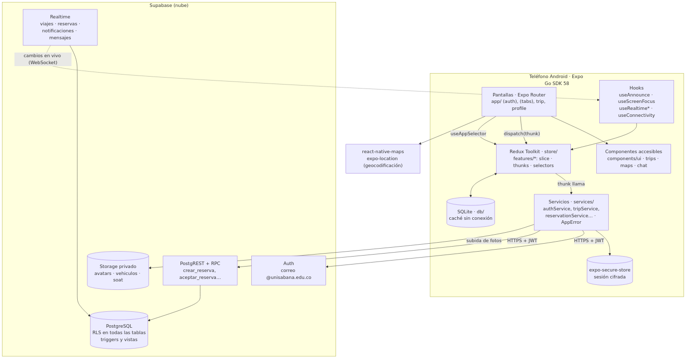
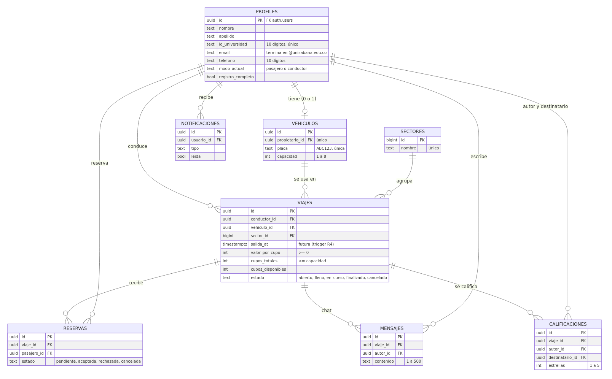
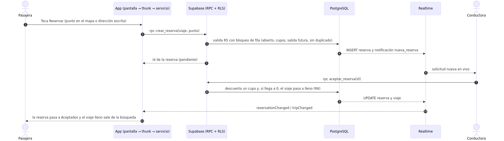

# CampusGo

### Conectando estudiantes, compartiendo trayectos

**Documento técnico final · Fase 3 (Entrega final)**

Sara Santacruz Corredor · Samuel Borda Munevar

Desarrollo de Aplicaciones Móviles · Profesor Santiago Rivadereina

Facultad de Ingeniería · Universidad de La Sabana

12 de noviembre de 2026

Repositorio: https://github.com/sarastacruz04/campusgo

## 1. Visión del producto, problema y estado del arte

### 1.1 Resumen ejecutivo y propuesta de valor

**CampusGo** es una aplicación móvil de carpooling para la comunidad de la Universidad de La Sabana. Su lema es *"Conectando estudiantes, compartiendo trayectos"*. Conecta a conductores y pasajeros de la misma universidad para compartir trayectos hacia y desde el campus en una **red cerrada**, a la que solo se entra con correo institucional `@unisabana.edu.co`, y **sin comisiones**. El conductor fija un valor de referencia por cupo, el pago ocurre fuera de la app y la app no procesa pagos.

**Propuesta de valor:** viajar al campus de forma más económica, social y sostenible, con personas de la propia comunidad, reglas claras de cupos y una interfaz que puede usar cualquier persona, incluida quien usa lector de pantalla, ve poco o maneja el celular con una mano.

**Usuarios:** estudiantes de pregrado de 18 a 25 años (principales) y docentes o administrativos jóvenes (secundarios). Cada persona usa la app en modo **pasajero** o **conductor**; el modo conductor exige un carro registrado.

| Persona | Perfil | Necesidad de accesibilidad | Cómo la atiende CampusGo |
| --- | --- | --- | --- |
| Valentina, 19 | Pasajera | Baja visión | Tema de alto contraste, texto hasta 200 % sin recortes, contraste ≥ 4,5:1 verificado por script |
| Andrés, 21 | Pasajero | Ceguera, usa TalkBack | Roles, etiquetas y estados en cada control; tarjetas de viaje como un solo foco; anuncios sin mover el foco |
| Camila, 22 | Conductora | Daltonismo rojo-verde | Ningún estado depende solo del color: ícono + texto + borde |
| Julián, 20 | Pasajero | Movilidad reducida, usa el celular con una mano | Áreas táctiles de 48 dp, `hitSlop`, acciones principales abajo, sin gestos complejos |
| Mariana, 18 | Conductora | TDAH y ansiedad | Registro por pasos con "Paso x de y", errores claros por campo, confirmación antes de acciones destructivas |

### 1.2 Problema validado y análisis competitivo

En la Fase 1 el equipo validó que muchos estudiantes viven fuera del campus y dependen de taxis o de transporte público irregular, con un gasto que los encuestados ubicaron entre 100.000 y 200.000 COP al mes. Este gasto suma congestión y emisiones en la Sabana de Bogotá. También identificó que ya existe un sistema informal, "Wheels", que funciona por grupos de WhatsApp: **hay demanda, pero falta una plataforma** con reglas, escalabilidad, seguridad y trazabilidad. La conectividad no es una barrera: en Colombia la penetración de internet móvil llegó a 91 de cada 100 personas (MinTIC, 2025).

La literatura respalda el enfoque. Rey-Merchán et al. (2022), en un panel de expertos sobre el carpooling de docentes, encontraron que el ahorro de combustible es el incentivo más fuerte y que el tiempo de viaje y la pérdida de independencia son las principales barreras. Javid et al. (2025) estudiaron la intención de estudiantes universitarios de compartir carro y encontraron que la actitud y las normas sociales pesan más, mientras la privacidad, la pérdida de libertad y la seguridad la frenan. Biard (2023) presenta el carpooling cotidiano como palanca de transición ecológica cuando se organiza en zonas y comunidades definidas.

| Criterio | Uber / Didi | BlaBlaCar | TRIBBU | **CampusGo (construido)** |
| --- | --- | --- | --- | --- |
| Enfoque | Público general, bajo demanda | Viajes interurbanos largos | Comunidades universitarias y empresas | Una universidad: trayectos diarios al campus |
| Comunidad cerrada | No | No | Sí, con correo de la universidad (UCM, s. f.) | **Sí: solo `@unisabana.edu.co`, validado en la app y en la base de datos** |
| Costo para el usuario | Tarifa con comisión | Costo compartido | Gratis para el usuario | **Gratis, sin comisión; valor de referencia por cupo** |
| Reglas de cupos | — | Reserva | Rutinas | **Cierre automático al llenarse (transacción en la base)** |
| Confianza | Calificaciones | Perfiles y opiniones | Comunidad | **Calificaciones por pares, chat solo entre participantes y RLS** |
| Accesibilidad declarada | General | General | No documentada | **26 compromisos WCAG 2.1/2.2 AA trazados y probados con TalkBack** |
| Sin conexión | No | Parcial | No documentado | **Caché local con aviso "Sin conexión"** |

Las brechas que deja la competencia para La Sabana son la falta de una red exclusiva y gratuita para la universidad, la ausencia de reglas de cupos y la accesibilidad sin evidencia. CampusGo las cubre con funciones ya construidas y probadas.

### 1.3 Innovación lograda

| Diferenciador | Justificación técnica (implementado) |
| --- | --- |
| Red cerrada institucional | Validación del dominio en la app (`lib/validators.ts`) y restricción `CHECK` en `profiles.email` en PostgreSQL; un correo de otro dominio se rechaza aunque se llame a la API directamente (TC-05). La verificación de **propiedad** del correo por código está implementada (`verifyOtp`), pero apagada (ver 5.2). |
| Cero comisiones | El valor por cupo es un dato del viaje; no hay módulo de pagos. |
| Cierre automático de cupos | RPC `aceptar_reserva` con bloqueo de fila (`SELECT … FOR UPDATE`): descuenta un cupo y, al llegar a 0, pasa el viaje a `lleno` en la misma transacción. Dos aceptaciones simultáneas no pueden sobrevender (TC-12). |
| Tiempo real | Supabase Realtime actualiza cupos, solicitudes, notificaciones y chat sin recargar (TC-12, TC-13, TC-16). |
| Seguridad por diseño | RLS en todas las tablas; 92 pruebas SQL de quién puede qué, 92 de 92 aprobadas (TC-23). |
| Sin conexión | Caché SQLite de viajes, reservas y perfil con hora de última actualización (TC-17). |
| Accesibilidad AA verificable | Componentes base que obligan por tipos a tener etiqueta, script de contraste en tres temas y auditoría con TalkBack (sección 3). |

## 2. Arquitectura e implementación técnica

### 2.1 Arquitectura de extremo a extremo

*Figura 1. Arquitectura: cliente Expo/React Native con Redux Toolkit, servicios y almacenamiento local; Supabase con Auth, PostgreSQL con RLS, Realtime y Storage.*

**Pila:** Expo SDK 58 (React Native 0.88, React 19), TypeScript estricto, Expo Router, Redux Toolkit, Supabase (`@supabase/supabase-js`), `expo-secure-store`, `expo-sqlite`, `react-native-maps` y `expo-location`. Todo corre en **Expo Go**, sin módulos nativos propios, y `npx expo-doctor` pasa 20 de 20 comprobaciones.

### 2.2 Decisiones arquitectónicas y estructura

- **Flujo de datos unidireccional:** pantalla → `dispatch(thunk)` → servicio → Supabase → reducer → selector → pantalla. Las pantallas nunca llaman a Supabase y los componentes de `components/ui` no conocen Redux: reciben props. Así cada capa se prueba sola.
- **Estructura modular:** `app/` (rutas), `components/` (ui, trips, maps, chat, ratings, notifications), `features/` (nueve dominios con `slice`, `thunks` y `selectors`), `services/` (un servicio por dominio y un tipo `AppError` con mensajes en español), `db/` (SQLite), `hooks/`, `theme/`, `lib/` y `supabase/` (migraciones, semilla y pruebas SQL).
- **Navegación con Expo Router:** grupos `(auth)` y `(tabs)`; la pestaña "Reservas" o "Creados" depende del modo. La guardia de sesión vive en `app/_layout.tsx`: sin sesión lleva a la bienvenida, con registro incompleto retoma el paso pendiente y con registro completo lleva a las pestañas.
- **Estado asíncrono:** `createAsyncThunk` con estados `idle`, `loading`, `succeeded` y `failed`; los errores llegan como `AppError` con `rejectWithValue`, y la interfaz ofrece "Reintentar". Las respuestas obsoletas se descartan comparando `requestId`, y las suscripciones Realtime se cierran en el *cleanup* de `useEffect`.
- **Sesión segura:** SecureStore puede rechazar valores de más de 2048 bytes, y la sesión puede ser más grande. Por eso el adaptador `services/secureSessionStorage.ts` genera una llave AES de 256 bits, la guarda en `expo-secure-store` (Keystore de Android o llavero de iOS) y guarda en AsyncStorage solo la sesión cifrada con AES-CTR, siguiendo el patrón que recomienda Supabase para React Native. La renovación del token se activa y se pausa con `AppState` (TC-21 y TC-22).
- **Rendimiento:** `FlatList` con `keyExtractor` estable, `renderItem` con `useCallback`, tarjetas con `React.memo`, paginación por rango de 20 con `onEndReached`, *debounce* de 300 ms en los filtros y selectores memoizados con `createSelector`. En la Etapa 8 se corrigió que Creados y Curso creaban funciones nuevas en cada render (eso anulaba `React.memo`), y las fotos se reducen a 1280 px y JPEG al 70 % antes de subirlas. La lista con 200 viajes se movió fluida en el teléfono (V5-04).

### 2.3 Modelo de datos y contratos

*Figura 2. Modelo de datos en PostgreSQL (Supabase). Las reglas de negocio viven en la base: restricciones, funciones RPC y triggers.*

Las nueve migraciones (`supabase/migrations/0001` a `0009`) crean ocho tablas, una vista de promedios de calificación, ocho funciones RPC transaccionales (`cambiar_modo`, `crear_reserva`, `aceptar_reserva`, `rechazar_reserva`, `cancelar_reserva`, `iniciar_viaje`, `finalizar_viaje` y `cancelar_viaje`), los triggers que crean el perfil y las notificaciones, la validación de viajes nuevos (R4) y las políticas RLS. Las funciones `SECURITY DEFINER` tienen `search_path` fijo. El contrato de cada tabla, RPC y servicio está en `docs/API_CONTRATOS.md`.

| Flujo | Contrato (entrada → salida) | Reglas en la base |
| --- | --- | --- |
| Registro | `authService.signUp(datos)` → cuenta activa; el trigger `handle_new_user` crea el perfil | Dominio institucional (`CHECK`), ID y teléfono de 10 dígitos |
| Crear viaje | `INSERT viajes` → viaje `abierto` | Política: conductor con carro y en modo conductor. Trigger: carro propio, salida futura, cupos ≤ capacidad |
| Reservar | `rpc crear_reserva(viaje, punto)` → id de reserva `pendiente` | Viaje abierto, con cupos y salida futura, sin reserva propia ni duplicada; sin INSERT directo |
| Aceptar | `rpc aceptar_reserva(id)` → reserva `aceptada` | Solo el conductor; bloqueo de fila; cierre automático al llegar a 0 cupos |

*Figura 3. Reserva con cierre automático: la RPC valida dentro de una transacción y Realtime lleva el cambio a las dos personas.*

## 3. Implementación y auditoría de accesibilidad

La propuesta aprobada en el Corte 2 tiene 26 compromisos en tres grupos: semántica (S), diseño visual (V) y ergonomía táctil (T). Cada uno está implementado en código, cubierto por pruebas automáticas y verificado en un teléfono Android con TalkBack.

**(a) Semántica para lectores de pantalla.** Todo lo táctil es un `Pressable` con `accessibilityRole`, `accessibilityLabel` en español y `accessibilityState` explícitos. TypeScript **obliga** a la etiqueta: `IconButton` no compila sin `accessibilityLabel` y `TextField` no compila sin `label`. Las tarjetas de viaje son **un solo foco** (`accessible` en el contenedor) con una etiqueta compuesta: "Colina. Conductor …. Sale 7:00 a. m. Valor 5.000 pesos. 2 cupos.". El selector Pasajero/Conductor es un `radiogroup` con estado `checked`. Los diálogos usan `accessibilityViewIsModal`, llevan el foco al título y lo devuelven al botón que los abrió. Los mensajes dinámicos (errores, carga, éxito, mensaje nuevo) se anuncian con `AccessibilityInfo.announceForAccessibility`. Se eligió esta API porque en la prueba con TalkBack la región viva no se oyó (decisión D-27, tomada con evidencia).

**(b) Diseño visual.** Hay tres temas (claro, oscuro y alto contraste) definidos como tokens. `npm run a11y:contrast` verifica 66 pares y falla si un texto queda bajo 4,5:1 o un elemento de interfaz bajo 3:1; hoy los 66 cumplen. Cada estilo de texto define `lineHeight` de al menos 1,4 veces el tamaño, para que no se recorten tildes, Ñ, ¿ ni ¡, y una prueba lo revisa en todas las variantes. Las fuentes escalan hasta 200 %, sin alturas fijas. Ningún estado depende solo del color: un error lleva ícono, texto y borde de 2 px.

**(c) Ergonomía táctil.** `TOUCH_MIN = Platform.select({ ios: 44, default: 48 })` es el mínimo de alto y ancho de botones, campos, radios y pestañas, y `hitSlop` completa el área de los íconos pequeños. El foco va al título al entrar a cada pantalla, el orden de foco sigue el orden visual y el teclado usa "Siguiente". Al terminar una acción, la app vibra (con un interruptor en Ajustes), muestra un mensaje con ícono y texto y lo anuncia. Las acciones destructivas piden confirmación y la opción segura va primero.

**Matriz trazable** (completa, con archivos y líneas, en `docs/MATRIZ_ACCESIBILIDAD.md`; *UT* = prueba unitaria, *TB* = TalkBack, *AS* = Accessibility Scanner, *CC* = script de contraste):

| ID | Mejora prometida (Corte 2) | Dónde se implementó | Prueba | Resultado |
| --- | --- | --- | --- | --- |
| S-01 | Roles correctos | ui/Button, IconButton, ScreenTitle, SegmentedToggle, BottomTabBar | UT, TB (F1–F4) | Aprobado |
| S-02 | Etiquetas en íconos; decorativos ocultos | ui/IconButton (label obligatorio), ui/Icon | UT, TB, AS | Aprobado |
| S-03 | Selector de modo como radiogroup | ui/SegmentedToggle, ui/ScreenLayout | UT, TB (F6) | Aprobado |
| S-04 | Tarjeta de viaje como un solo foco | components/trips/TripCard | UT, TB (F3-04) | Aprobado |
| S-05 | Formularios con etiqueta, pista y error en texto | ui/TextField, lib/validators | UT, TB (F1, F4) | Aprobado |
| S-06 | Estados selected, disabled, busy, checked | ui/Button, BottomTabBar, RadioGroup | UT, TB | Aprobado |
| S-07 | Mensajes dinámicos sin mover el foco | hooks/useAnnounce | UT, TB | Aprobado en lo ejecutado (F3-05 sin probar con TalkBack) |
| S-08 | Diálogos modales y foco | ui/ConfirmDialog | UT, TB (F5) | Aprobado |
| S-09 | Alternativas textuales (mapa, fotos, logo) | components/maps/MapPicker, ui/PhotoPicker, ui/Logo | UT, TB (F3-07) | Aprobado |
| V-01 | Contraste verificado por script | theme/colors, scripts/check-contrast | CC 66/66, AS | Aprobado |
| V-02 | Placeholder legible y etiqueta visible | ui/TextField | CC, UT | Aprobado |
| V-03 | Controles sobre azul legibles | ui/SegmentedToggle, components/trips/TripFilters | CC, TB | Aprobado |
| V-04 | Íconos de estado con 3:1 | ui/ConfirmDialog, ui/PhotoPicker | CC, AS | Aprobado |
| V-05 | No depender solo del color | ui/TextField, StatusBanner, BottomTabBar | UT, VA | Aprobado |
| V-06 | Escalado de fuente al 200 % | ui/AppText, theme/typography | UT, VA-05 | Aprobado |
| V-07 | lineHeight ≥ 1,4 y sin espaciado negativo | theme/typography | UT, VA-05 | Aprobado |
| V-08 | Temas y preferencias persistentes | theme/ThemeProvider, app/settings/accessibility | UT, VA-01 a VA-03 | Aprobado |
| V-09 | Respeto a reducir movimiento | hooks/useReduceMotion | UT, VA-04 | Aprobado |
| T-01 | Áreas táctiles de 44 pt y 48 dp | theme/layout (TOUCH_MIN) | UT, AS | Aprobado |
| T-02 | hitSlop y 8 dp entre objetivos | ui/IconButton, theme/layout | UT, VA-08 | Aprobado |
| T-03 | Orden de foco y foco al título | hooks/useScreenFocus, ui/ScreenTitle | UT, TB | Aprobado |
| T-04 | Háptica, mensaje y anuncio | hooks/useHaptics, ui/StatusBanner | UT, TB, VA-06 | Aprobado |
| T-05 | Carga y errores de red con "Reintentar" | ui/LoadingState, StatusBanner | UT, TC-17, TC-18 | Aprobado en lo ejecutado |
| T-06 | Confirmaciones destructivas seguras | ui/ConfirmDialog | UT, TB (F5, F6) | Aprobado |
| T-07 | Sin gestos complejos; dirección escrita | components/maps/MapPicker, trip/[id]/reserve | UT, TB (F3-08) | Aprobado |
| T-08 | Registro por pasos y autocompletar | ui/StepIndicator, lib/registerSteps | UT, TB (F1) | Aprobado |

## 4. Pruebas y validación

**Pruebas automáticas.** `npm test` (jest-expo y Testing Library) ejecuta **259 pruebas en 37 archivos**, todas aprobadas: componentes (roles, etiquetas, tamaños mínimos, `lineHeight`), reducers, selectores, thunks con servicios simulados *solo dentro de las pruebas*, validadores y flujos de pantalla (inicio de sesión con error, registro con validación, reserva, crear viaje con campos faltantes). A esto se suman el script de contraste (66 de 66) y **92 pruebas SQL de RLS** ejecutadas en Supabase (92 de 92). `typecheck` y `lint` pasan antes de cada commit.

**Casos funcionales en el teléfono** (Samsung Galaxy A35 5G, Android 16, Expo Go; ejecutados por Sara, 11 y 12 de noviembre de 2026; detalle en `docs/PRUEBAS.md`):

| Grupo | Casos | Resultado |
| --- | --- | --- |
| Caminos felices | Registro con y sin carro, inicio de sesión, buscar, reservar, crear viaje, aceptar hasta llenar, iniciar y finalizar, calificar, chat (TC-01–03, 06, 07, 10, 12, 14–16) | Aprobados |
| Errores de validación | Credenciales incorrectas, otro dominio, reserva duplicada, campos faltantes (TC-04, 05, 08, 11) | Aprobados |
| Red | Sin conexión con caché y banner; error de red con "Reintentar" (TC-17, 18) | Aprobados |
| Reglas y sesión | Cancelar, rechazar, cambio de modo sin carro, eliminar carro, cerrar sesión, sesión persistente (TC-09, 13, 19–22) | Aprobados |
| Seguridad | RLS: nadie lee datos ajenos (TC-23) | Aprobado, 92 de 92 |

Las pruebas encontraron **fallas reales que se corrigieron**, cada una con su prueba nueva:
- la hora "6:00" se rechazaba y su error aparecía bajo la fecha (TC-10);
- el registro mostraba el error de un inicio de sesión anterior (TC-05);
- un error 5xx del servidor se anunciaba como "Sin conexión";
- la prueba de RLS reveló tres huecos: teléfono y correo legibles por cualquier cuenta, un trigger de `modo_actual` que nunca se disparaba porque era `SECURITY DEFINER`, y reservas "aceptadas" insertables sin la RPC. La migración 0009 los cerró: de 79 de 82 se pasó a 92 de 92.

**Auditoría de accesibilidad en dispositivo** (`docs/AUDITORIA_ACCESIBILIDAD.md`): los seis flujos (registro, inicio de sesión con error, buscar y reservar, crear viaje, cancelar reserva y eliminar carro, cambio de modo y cierre de sesión) se recorrieron con **TalkBack**: 45 filas aprobadas, 1 no aplica (el código de correo) y 1 no ejecutada (el anuncio de "Cargando más viajes…", que necesita más de 20 viajes). Las variantes de tema oscuro, alto contraste, sistema, reducir animaciones, fuente y pantalla al máximo y vibración apagada se aprobaron, y **Accessibility Scanner no dio avisos**. En rendimiento, la lista de 200 viajes es fluida (V5-04); las mediciones con el Profiler (R-02 a R-06) las reporta Sara como aprobadas, pero no quedó captura guardada.

## 5. Conclusiones, limitaciones y trabajo futuro

### 5.1 Lecciones aprendidas y alcance logrado

Se construyeron todas las pantallas previstas: las del Figma y cuatro nuevas (notificaciones, chat, calificar y ajustes de accesibilidad), con datos reales de Supabase y sin listas fijas. Las lecciones principales:

1. **Las reglas de negocio deben vivir en la base de datos.** La prueba de RLS encontró huecos que la app nunca habría mostrado, porque la app sí usaba las RPC. Solo probando la API directamente, como un atacante, aparecieron.
2. **La accesibilidad se decide con evidencia del dispositivo.** La región viva que proponía la Fase 2 no se oyó con TalkBack; la cambiamos por `announceForAccessibility` después de probarla, no por suposición.
3. **Componentes que obligan por tipos** (la etiqueta como prop obligatoria) evitan olvidos en las 20 pantallas mejor que una revisión manual.
4. **El orden importa:** probar en el teléfono antes de la entrega encontró cuatro fallas que las pruebas automáticas no veían, porque dependían de datos reales, de la red o de la configuración del servidor.

### 5.2 Limitaciones

- **Verificación de propiedad del correo apagada (D-68).** Supabase solo deja enviar el código de 6 dígitos con un servidor de correo propio, y con el de Gmail los envíos fallaron (504 y 429; ningún correo llegó). Se apagó la confirmación: el dominio `@unisabana.edu.co` se sigue exigiendo en la app y en la base, pero **no se comprueba que la persona sea dueña del correo**. La pantalla del código sigue en el código y vuelve sola si se activa la confirmación.
- **iOS sin probar:** el equipo solo tiene Android. Las propiedades específicas de iOS están implementadas y cubiertas con pruebas unitarias, pero VoiceOver y Accessibility Inspector no se ejecutaron.
- **Sin pagos ni notificaciones push remotas:** las notificaciones son internas, por Realtime, porque las push remotas no funcionan de forma confiable en Expo Go.
- **Rendimiento:** las mediciones con el Profiler no tienen captura guardada, y el anuncio de carga de más páginas no se verificó con TalkBack.
- **Participación:** Samuel hizo 22 commits (base de datos, autenticación y registro, flujo de conductor, calificaciones y notificaciones). Los 7 de la base de datos aparecen con el nombre "user.email" por una configuración de Git de ese día, pero con su correo. Sara hizo el resto, incluida toda la Etapa 8, que Samuel no pudo ejecutar por parciales. El historial no se reescribió: se deja tal cual.

### 5.3 Hoja de ruta

1. Servidor de correo con dominio propio, o **inicio de sesión institucional (SSO)**, para volver a verificar la propiedad del correo.
2. *Development build* para **notificaciones push** reales y pruebas en iOS con VoiceOver.
3. **Rutas recurrentes** (viajes que se repiten cada semana) y división de gastos con pagos integrados.
4. Emparejamiento inteligente entre pasajeros y conductores y mapas de calor de demanda por sector, como plantea el estado del arte en carpooling institucional (Liftango, s. f.).
5. Publicación en las tiendas y licencia institucional para que la app siga siendo gratuita para los estudiantes.

## Referencias

Biard, N. (2023, septiembre). *Is there a passenger in the car? Summary document*. CITEGO. https://citego.org/bdf_fiche-document-3426_es.html

Expo. (s. f.). *Expo SDK 58 reference*. Recuperado el 12 de noviembre de 2026, de https://docs.expo.dev/versions/v58.0.0/

Javid, M. A., Al-Shehhi, M. I. S., & Al-Youqabi, M. H. S. (2025). Students' intentions toward carpooling in Sohar, Oman: Importance of various motivating factors, incentives, and barriers. *Transactions on Transport Sciences, 16*(2), 23–32. https://doi.org/10.5507/tots.2024.024

Liftango. (s. f.). *Carpool*. Recuperado el 12 de noviembre de 2026, de https://www.liftango.com/carpool

Ministerio de Tecnologías de la Información y las Comunicaciones [MinTIC]. (2025, 28 de febrero). *Colombia superó los 48 millones de accesos a Internet móvil en el tercer trimestre del 2024*. https://www.mintic.gov.co/portal/715/w3-article-399983.html

Rey-Merchán, M. C., López-Arquillos, A., & Pires Rosa, M. (2022). Carpooling systems for commuting among teachers: An expert panel analysis of their barriers and incentives. *International Journal of Environmental Research and Public Health, 19*(14), 8533. https://ideas.repec.org/a/gam/jijerp/v19y2022i14p8533-d861326.html

React Native. (s. f.). *Accessibility*. Recuperado el 12 de noviembre de 2026, de https://reactnative.dev/docs/accessibility

Supabase. (s. f.). *Row Level Security*. Recuperado el 12 de noviembre de 2026, de https://supabase.com/docs/guides/database/postgres/row-level-security

Supabase. (s. f.). *Email templates*. Recuperado el 12 de noviembre de 2026, de https://supabase.com/docs/guides/auth/auth-email-templates

Universidad Complutense de Madrid [UCM]. (s. f.). *Coche compartido*. Recuperado el 12 de noviembre de 2026, de https://www.ucm.es/sostenibilidad/coche-compartido

World Wide Web Consortium [W3C]. (2018). *Web Content Accessibility Guidelines (WCAG) 2.1*. https://www.w3.org/TR/WCAG21/

World Wide Web Consortium [W3C]. (2023). *Web Content Accessibility Guidelines (WCAG) 2.2*. https://www.w3.org/TR/WCAG22/

